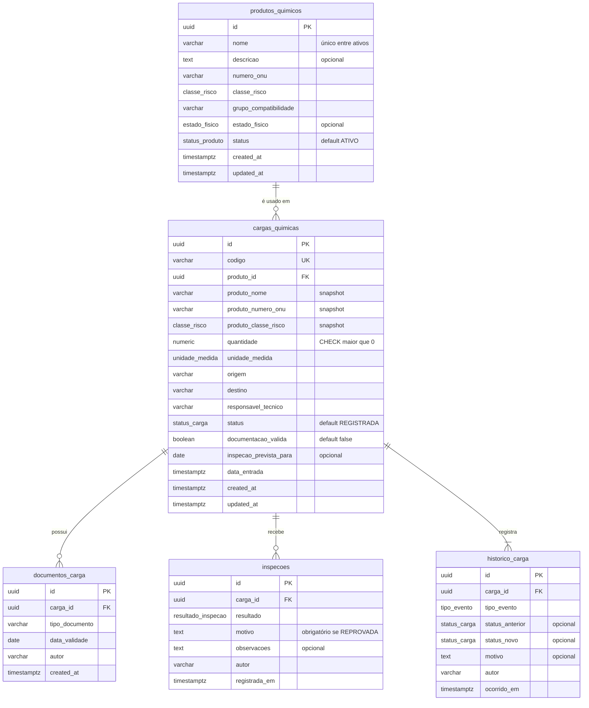
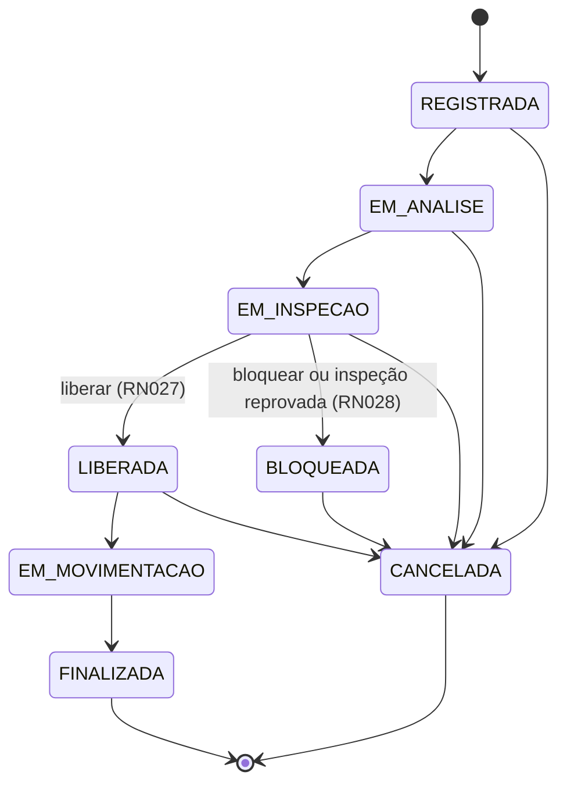

# QuimiPort — Modelagem de Dados

**Sistema:** Gestão de Cargas Químicas Portuárias  
**Contexto:** Tech Challenge Fase 2 — Pós Tech Full Stack Development  
**Documentos relacionados:** QuimiPort - Regras de Negócio (v1.3), QuimiPort - Épicos e Histórias de Usuário (v1.3), QuimiPort - Regras de Negócio Não Implementadas (v1.2)  
**Versão:** 1.2

---

## Histórico de alterações

| Versão | Data | Responsável | Descrição |
|---|---|---|---|
| 1.0 | 05/10/2026 | Ionara Lima | Versão inicial: escolha do banco, DER, dicionário de dados, controle de status, restrições no banco e evolução prevista. |
| 1.1 | 05/10/2026 | Ionara Lima | Alinhamento à máquina de estados do enunciado (Regras de Negócio v1.2): remoção do desbloqueio. Retirada da coluna `ultimo_desbloqueio_em` e do evento `DESBLOQUEIO`; simplificação da verificação de inspeção aprovada (RN027); inclusão da tabela de transições permitidas no controle de status; desbloqueio registrado como evolução futura. |
| 1.2 | 05/10/2026 | Ionara Lima | Inclusão da seção "Convenções", com o padrão de nomenclatura entre documentos, banco de dados e API. Retirada da evolução prevista para a cadeia Classificação de Risco → Risco → Documento Obrigatório e para o responsável técnico como entidade. Padronização da estrutura do documento. Detalhamento das alterações abaixo. |

### Detalhamento da versão 1.2

- Inclusão da seção 1, "Convenções", com as regras de nomenclatura e a tabela de correspondência entre os nomes usados nos documentos e os nomes técnicos do banco e da API. As demais seções foram renumeradas.
- Retirada das linhas de evolução da cadeia Classificação de Risco → Risco → Documento Obrigatório, dos documentos exigidos por risco, das subclasses de risco, da exclusão lógica de cadastros auxiliares e do responsável técnico como entidade, que deixaram de fazer parte do sistema (Regras de Negócio v1.3).
- Ajuste da justificativa de evolução futura do PostgreSQL e da descrição do armazenamento do responsável técnico.
- Padronização do cabeçalho ("Documentos relacionados") no mesmo formato dos demais documentos do projeto.

---

## Sumário

1. Convenções
2. Objetivo
3. Banco de dados escolhido
4. Diagrama entidade-relacionamento
5. Dicionário de dados
6. Como os produtos químicos são armazenados
7. Como as cargas químicas são armazenadas
8. Como uma carga se relaciona com um produto químico
9. Como o status da carga é controlado
10. Consultas e atualizações implementadas
11. Divisão das validações entre banco e domínio
12. Como os dados poderão evoluir nas próximas fases
13. Como aplicar a modelagem (migrations)

---

## 1. Convenções

### Siglas

- **RN** = Regra de Negócio, no documento "QuimiPort - Regras de Negócio".
- **US** = User Story (história de usuário), no documento "QuimiPort - Épicos e Histórias de Usuário".
- **RNF** = Requisito Não Funcional, no documento "QuimiPort - Épicos e Histórias de Usuário".

### Regras de nomenclatura

| Elemento | Padrão | Exemplo |
|---|---|---|
| Nome nos documentos | Português, com acentos, em letras minúsculas no meio da frase | classe de risco, Em análise |
| Tabela no banco | `snake_case`, no plural, sem acentos | `cargas_quimicas` |
| Coluna no banco | `snake_case`, no singular, sem acentos | `numero_onu` |
| Chave estrangeira | nome da tabela referenciada no singular + `_id` | `produto_id`, `carga_id` |
| Coluna de snapshot | prefixo da tabela de origem + nome da coluna original | `produto_classe_risco` |
| Datas de controle | `created_at` e `updated_at` | `created_at` |
| Tipo enumerado no banco | `snake_case`, no singular | `status_carga` |
| Valor de enum | `MAIUSCULAS_COM_SUBLINHADO`, sem acentos | `EM_ANALISE` |
| Model no Prisma | `PascalCase`, no singular, mapeado para a tabela com `@@map` | `CargaQuimica` → `cargas_quimicas` |
| Campo no Prisma e na API | `camelCase`, mapeado para a coluna com `@map` | `numeroOnu` → `numero_onu` |

### Correspondência de campos

| Nome nos documentos | Campo no Prisma e na API | Tabela e coluna no banco |
|---|---|---|
| Produto químico | `ProdutoQuimico` | `produtos_quimicos` |
| Nome | `nome` | `produtos_quimicos.nome` |
| Descrição | `descricao` | `produtos_quimicos.descricao` |
| Número ONU | `numeroOnu` | `produtos_quimicos.numero_onu` |
| Classe de risco | `classeRisco` | `produtos_quimicos.classe_risco` |
| Grupo de compatibilidade | `grupoCompatibilidade` | `produtos_quimicos.grupo_compatibilidade` |
| Estado físico | `estadoFisico` | `produtos_quimicos.estado_fisico` |
| Status do produto | `status` | `produtos_quimicos.status` |
| Carga química | `CargaQuimica` | `cargas_quimicas` |
| Código da carga | `codigo` | `cargas_quimicas.codigo` |
| Produto associado | `produtoId` | `cargas_quimicas.produto_id` |
| Quantidade | `quantidade` | `cargas_quimicas.quantidade` |
| Unidade de medida | `unidadeMedida` | `cargas_quimicas.unidade_medida` |
| Origem | `origem` | `cargas_quimicas.origem` |
| Destino | `destino` | `cargas_quimicas.destino` |
| Responsável técnico | `responsavelTecnico` | `cargas_quimicas.responsavel_tecnico` |
| Documentação válida | `documentacaoValida` | `cargas_quimicas.documentacao_valida` |
| Data de entrada | `dataEntrada` | `cargas_quimicas.data_entrada` |
| Status da carga | `status` | `cargas_quimicas.status` |
| Documento da carga | `DocumentoCarga` | `documentos_carga` |
| Tipo de documento | `tipoDocumento` | `documentos_carga.tipo_documento` |
| Data de validade | `dataValidade` | `documentos_carga.data_validade` |
| Inspeção | `Inspecao` | `inspecoes` |
| Resultado da inspeção | `resultado` | `inspecoes.resultado` |
| Histórico da carga | `HistoricoCarga` | `historico_carga` |
| Data de criação | `createdAt` | `created_at` |
| Data de atualização | `updatedAt` | `updated_at` |

### Correspondência de valores

| Campo | Nome nos documentos | Valor no banco e na API |
|---|---|---|
| Status do produto | Ativo, Inativo | `ATIVO`, `INATIVO` |
| Status da carga | Registrada | `REGISTRADA` |
| | Em análise | `EM_ANALISE` |
| | Em inspeção | `EM_INSPECAO` |
| | Liberada | `LIBERADA` |
| | Bloqueada | `BLOQUEADA` |
| | Em movimentação | `EM_MOVIMENTACAO` |
| | Finalizada | `FINALIZADA` |
| | Cancelada | `CANCELADA` |
| Resultado da inspeção | Aprovada, Reprovada | `APROVADA`, `REPROVADA` |
| Classe de risco | Classe 1 a Classe 9 | `CLASSE_1` a `CLASSE_9` |
| Estado físico | Sólido, Líquido, Gasoso | `SOLIDO`, `LIQUIDO`, `GASOSO` |
| Unidade de medida | kg, t, L, m³ | `KG`, `T`, `L`, `M3` |

---

## 2. Objetivo

Este documento apresenta a modelagem de dados da API do QuimiPort na Fase 2: tabelas, campos, chaves primárias, chaves estrangeiras, relacionamentos e restrições. Explica como produtos e cargas são armazenados, como se relacionam, como o status da carga é controlado e como o modelo poderá evoluir.

Os artefatos de implementação estão em:

| Artefato | Caminho | Conteúdo |
|---|---|---|
| Schema Prisma | `prisma/schema.prisma` | Tabelas, enums, chaves e índices |
| Restrições complementares | `prisma/migrations/<timestamp>_init/migration.sql` (conteúdo de `constraints.sql`) | CHECKs, índice único parcial e trigger append-only, que o Prisma não expressa no schema |

---

## 3. Banco de dados escolhido

**Escolha:** PostgreSQL 16, acessado pela aplicação por meio do Prisma ORM (versão 6).

### Justificativa

| Critério do enunciado | Análise |
|---|---|
| **Tipo de dado** | Os dados têm estrutura fixa e conhecida: cada produto e cada carga possuem sempre os mesmos campos, com tipos definidos (texto, número decimal, data, valores enumerados). Esse perfil é atendido de forma natural por tabelas com colunas tipadas. A quantidade da carga exige precisão decimal (`numeric`), sem os erros de arredondamento de ponto flutuante. |
| **Relacionamentos** | O domínio é fortemente relacional: uma carga referencia obrigatoriamente um produto (RN004), e documentos, inspeções e eventos de histórico pertencem a uma carga. A chave estrangeira garante no próprio banco que nenhuma carga aponte para um produto inexistente e que nenhum produto com cargas seja apagado. |
| **Consistência das regras** | Uma mudança de status exige alterar a carga e inserir o evento de histórico ao mesmo tempo (RN011). As transações ACID do PostgreSQL garantem que as duas operações aconteçam juntas ou não aconteçam. Enums, CHECKs e triggers reforçam no banco as regras mais críticas (status válidos, quantidade positiva, histórico imutável). |
| **Evolução futura** | As próximas fases preveem novas funcionalidades, como autenticação com perfis de usuário e anexo de arquivos aos documentos da carga (seção 12). Elas entram como novas tabelas, colunas e chaves estrangeiras, que o modelo relacional absorve por migrations, sem reestruturar os dados existentes. Se surgir necessidade de dados flexíveis, o PostgreSQL oferece colunas `jsonb` sem trocar de banco. |
| **Coerência com a Fase 1** | A Fase 1 definiu a Arquitetura Hexagonal com o banco como adapter de saída. O Prisma fica isolado na camada de infraestrutura (repositórios), e o domínio não depende dele. |

### Por que não MongoDB

O MongoDB seria adequado se os dados fossem heterogêneos ou se a carga fosse lida sempre como um documento único, sem consultas cruzadas. No QuimiPort, os produtos são compartilhados por muitas cargas, as consultas filtram cargas por status e por produto, e as regras exigem integridade referencial e atomicidade entre carga e histórico. No MongoDB, essas garantias ficariam a cargo do código da aplicação.

---

## 4. Diagrama entidade-relacionamento



### Relacionamentos

| Relacionamento | Cardinalidade | Chave estrangeira | Ação ao excluir o pai |
|---|---|---|---|
| Produto químico → Carga química | 1:N (um produto, zero ou muitas cargas; toda carga tem exatamente um produto) | `cargas_quimicas.produto_id` → `produtos_quimicos.id` | `RESTRICT` |
| Carga química → Documento da carga | 1:N | `documentos_carga.carga_id` → `cargas_quimicas.id` | `RESTRICT` |
| Carga química → Inspeção | 1:N | `inspecoes.carga_id` → `cargas_quimicas.id` | `RESTRICT` |
| Carga química → Histórico | 1:N (toda carga tem ao menos o evento de registro) | `historico_carga.carga_id` → `cargas_quimicas.id` | `RESTRICT` |

Todas as chaves estrangeiras usam `RESTRICT`: o banco impede a exclusão física de qualquer registro referenciado. Isso reforça a RN015, segundo a qual a inativação de produto e o cancelamento de carga são sempre lógicos.

---

## 5. Dicionário de dados

### 5.1 Tipos enumerados

| Enum | Valores | Regra |
|---|---|---|
| `status_produto` | `ATIVO`, `INATIVO` | RN021 |
| `classe_risco` | `CLASSE_1` (Explosivos), `CLASSE_2` (Gases), `CLASSE_3` (Líquidos inflamáveis), `CLASSE_4` (Sólidos inflamáveis), `CLASSE_5` (Oxidantes e peróxidos orgânicos), `CLASSE_6` (Tóxicas e infectantes), `CLASSE_7` (Radioativos), `CLASSE_8` (Corrosivos), `CLASSE_9` (Diversos) | RN002, RN014 |
| `estado_fisico` | `SOLIDO`, `LIQUIDO`, `GASOSO` | US001 |
| `unidade_medida` | `KG`, `T`, `L`, `M3` | US003 |
| `status_carga` | `REGISTRADA`, `EM_ANALISE`, `EM_INSPECAO`, `LIBERADA`, `BLOQUEADA`, `EM_MOVIMENTACAO`, `FINALIZADA`, `CANCELADA` | RN022 |
| `resultado_inspecao` | `APROVADA`, `REPROVADA` | RN025 |
| `tipo_evento` | `REGISTRO`, `MUDANCA_STATUS`, `DOCUMENTO_REGISTRADO`, `DOCUMENTACAO_VALIDADA`, `INSPECAO_REGISTRADA`, `BLOQUEIO`, `LIBERACAO`, `CANCELAMENTO` | RN011 |

As classes de risco seguem as nove classes de produtos perigosos da ONU para transporte.

### 5.2 `produtos_quimicos`

| Coluna | Tipo | Nulo | Padrão | Restrições | Regra |
|---|---|---|---|---|---|
| `id` | `uuid` | Não | gerado pela aplicação | **PK** | — |
| `nome` | `varchar(150)` | Não | — | CHECK não vazio; único entre ativos (case-insensitive, com trim) | RN001, US001 |
| `descricao` | `text` | Sim | — | — | US001 |
| `numero_onu` | `varchar(10)` | Não | — | — | US001 |
| `classe_risco` | `classe_risco` | Não | — | valores do enum | RN002, RN014 |
| `grupo_compatibilidade` | `varchar(5)` | Não | — | — | US001 |
| `estado_fisico` | `estado_fisico` | Sim | — | valores do enum | US001 |
| `status` | `status_produto` | Não | `ATIVO` | valores do enum | RN021 |
| `created_at` | `timestamptz(3)` | Não | `now()` | — | US001 |
| `updated_at` | `timestamptz(3)` | Não | atualizado pelo Prisma | — | US028 |

**Índices:** `produtos_quimicos_pkey` (id), `produtos_quimicos_status_idx` (status), `produtos_quimicos_nome_ativo_uk` (único parcial em `lower(btrim(nome))` onde `status = 'ATIVO'`).

### 5.3 `cargas_quimicas`

| Coluna | Tipo | Nulo | Padrão | Restrições | Regra |
|---|---|---|---|---|---|
| `id` | `uuid` | Não | gerado pela aplicação | **PK** | — |
| `codigo` | `varchar(30)` | Não | — | **UNIQUE**; CHECK não vazio | RN026 |
| `produto_id` | `uuid` | Não | — | **FK** → `produtos_quimicos.id` | RN004 |
| `produto_nome` | `varchar(150)` | Não | — | snapshot | RN012 |
| `produto_numero_onu` | `varchar(10)` | Não | — | snapshot | RN012 |
| `produto_classe_risco` | `classe_risco` | Não | — | snapshot; classe de risco herdada do produto | RN004, RN012 |
| `quantidade` | `numeric(14,3)` | Não | — | CHECK `> 0` | RN004 |
| `unidade_medida` | `unidade_medida` | Não | — | valores do enum | US003 |
| `origem` | `varchar(150)` | Não | — | — | US003 |
| `destino` | `varchar(150)` | Não | — | — | US003 |
| `responsavel_tecnico` | `varchar(150)` | Não | — | CHECK não vazio | RN009 |
| `status` | `status_carga` | Não | `REGISTRADA` | valores do enum | RN022, RN024 |
| `documentacao_valida` | `boolean` | Não | `false` | — | US007 |
| `inspecao_prevista_para` | `date` | Sim | — | — | US008 |
| `data_entrada` | `timestamptz(3)` | Não | — | — | US003 |
| `created_at` | `timestamptz(3)` | Não | `now()` | — | — |
| `updated_at` | `timestamptz(3)` | Não | atualizado pelo Prisma | — | — |

**Índices:** `cargas_quimicas_pkey` (id), `cargas_quimicas_codigo_key` (único em codigo), `cargas_quimicas_status_idx` (status), `cargas_quimicas_produto_id_idx` (produto_id).

### 5.4 `documentos_carga`

| Coluna | Tipo | Nulo | Padrão | Restrições | Regra |
|---|---|---|---|---|---|
| `id` | `uuid` | Não | gerado pela aplicação | **PK** | — |
| `carga_id` | `uuid` | Não | — | **FK** → `cargas_quimicas.id` | RN019 |
| `tipo_documento` | `varchar(100)` | Não | — | CHECK não vazio | US006 |
| `data_validade` | `date` | Não | — | — | RN013, US006 |
| `autor` | `varchar(150)` | Não | — | — | RNF005 |
| `created_at` | `timestamptz(3)` | Não | `now()` | — | — |

**Índices:** `documentos_carga_pkey` (id), `documentos_carga_carga_id_idx` (carga_id).

A situação "Vencido" (US006, cenário 02) **não é armazenada**: é calculada na consulta, comparando `data_validade` com a data corrente. Um valor armazenado ficaria desatualizado no dia seguinte ao vencimento.

### 5.5 `inspecoes`

| Coluna | Tipo | Nulo | Padrão | Restrições | Regra |
|---|---|---|---|---|---|
| `id` | `uuid` | Não | gerado pela aplicação | **PK** | — |
| `carga_id` | `uuid` | Não | — | **FK** → `cargas_quimicas.id` | US009 |
| `resultado` | `resultado_inspecao` | Não | — | valores do enum | RN025 |
| `motivo` | `text` | Sim | — | CHECK: obrigatório quando `REPROVADA` | RN025 |
| `observacoes` | `text` | Sim | — | — | US009 |
| `autor` | `varchar(150)` | Não | — | — | RNF005 |
| `registrada_em` | `timestamptz(3)` | Não | `now()` | — | RN027 |

**Índices:** `inspecoes_pkey` (id), `inspecoes_carga_id_registrada_em_idx` (carga_id, registrada_em desc), usado para buscar a inspeção mais recente de uma carga.

### 5.6 `historico_carga`

| Coluna | Tipo | Nulo | Padrão | Restrições | Regra |
|---|---|---|---|---|---|
| `id` | `uuid` | Não | gerado pela aplicação | **PK** | — |
| `carga_id` | `uuid` | Não | — | **FK** → `cargas_quimicas.id` | RN011 |
| `tipo_evento` | `tipo_evento` | Não | — | valores do enum | RN011 |
| `status_anterior` | `status_carga` | Sim | — | nulo no evento de registro | RN011 |
| `status_novo` | `status_carga` | Sim | — | CHECK: obrigatório em eventos que mudam status | RN011 |
| `motivo` | `text` | Sim | — | — | RN028, US005 |
| `autor` | `varchar(150)` | Não | — | — | RNF005 |
| `ocorrido_em` | `timestamptz(3)` | Não | `now()` | — | RNF005 |

**Índices:** `historico_carga_pkey` (id), `historico_carga_carga_id_ocorrido_em_idx` (carga_id, ocorrido_em desc), que atende à linha do tempo em ordem cronológica reversa (US015).

**Imutabilidade:** triggers rejeitam `UPDATE`, `DELETE` e `TRUNCATE` na tabela (seção 9.4).

### 5.7 Autor das operações

A Fase 2 não implementa autenticação (RN020 não implementada). As colunas `autor` recebem o identificador informado pelo cliente no cabeçalho HTTP `X-Usuario` e, quando ausente, o valor `sistema`. Quando a autenticação for implementada, o autor passará a vir do usuário autenticado, sem alteração nas tabelas (seção 12).

---

## 6. Como os produtos químicos são armazenados

Cada produto químico é uma linha da tabela `produtos_quimicos`, identificada por um UUID.

- **Campos obrigatórios:** nome (RN001) e classe de risco (RN002) são `NOT NULL`. O nome também tem um CHECK que rejeita texto vazio ou formado só por espaços.
- **Valores controlados:** a classe de risco e o status são tipos enumerados do PostgreSQL. O banco rejeita qualquer valor fora da lista (RN014, RN021).
- **Unicidade do nome:** um índice único parcial impede dois produtos **ativos** com o mesmo nome, sem diferenciar maiúsculas de minúsculas e ignorando espaços nas pontas (US001, cenário 04). Produtos inativos ficam fora do índice, então um produto pode ser inativado e um novo cadastrado com o mesmo nome.
- **Inativação lógica:** o endpoint `PATCH /produtos-quimicos/:id/inativar` altera `status` para `INATIVO` e atualiza `updated_at`. O registro nunca é apagado (RN015), e a chave estrangeira com `RESTRICT` impede a exclusão física de produtos com cargas.
- **Uso em novas cargas:** o caso de uso de registro de carga lê o produto e rejeita o registro quando o status é `INATIVO` (RN003). Cargas já registradas continuam apontando para o produto inativo normalmente.

---

## 7. Como as cargas químicas são armazenadas

Cada carga química é uma linha da tabela `cargas_quimicas`, identificada por um UUID e por um código de negócio único (RN026).

- **Dados obrigatórios:** produto, quantidade, unidade, origem, destino, responsável técnico e data de entrada são `NOT NULL`. A quantidade é `numeric(14,3)` com CHECK `> 0` (RN004).
- **Status inicial:** o valor padrão da coluna `status` é `REGISTRADA` (RN024).
- **Snapshot do produto (RN012):** no registro, o nome, o número ONU e a classe de risco do produto são copiados para as colunas `produto_*` da carga. Se o produto for editado depois (US028), a carga mantém os dados vigentes no momento do registro. A classe de risco da carga é, portanto, herdada do produto e não informada pelo cliente (RN004).
- **Responsável técnico:** armazenado como texto na própria carga, com o nome do responsável informado no registro (RN009).
- **Documentação obrigatória:** cada documento é uma linha em `documentos_carga`, com tipo e data de validade, sem upload de arquivo (RN019).
- **Inspeções:** cada resultado é uma linha em `inspecoes`. Inspeções anteriores nunca são apagadas, o que preserva a trilha de auditoria.
- **Histórico:** cada evento relevante é uma linha em `historico_carga` (seção 9.4).
- **Cancelamento lógico:** `PATCH /cargas-quimicas/:id/cancelar` altera o status para `CANCELADA` e registra o motivo no histórico. A carga permanece armazenada (RN015).

---

## 8. Como uma carga se relaciona com um produto químico

O relacionamento é **1:N**: um produto pode estar em zero ou muitas cargas, e cada carga referencia exatamente um produto.

- A coluna `cargas_quimicas.produto_id` é `NOT NULL` e é **chave estrangeira** para `produtos_quimicos.id`. O banco rejeita uma carga sem produto ou com um produto inexistente (RN004).
- A ação `ON DELETE RESTRICT` impede apagar um produto que tenha cargas.
- A regra de produto inativo (RN003) não é uma restrição estrutural, porque depende do status do produto **no momento do registro**: um produto inativado depois continua válido para as cargas antigas. Por isso, ela é verificada no caso de uso de registro, dentro da mesma transação que insere a carga.
- O índice `cargas_quimicas_produto_id_idx` acelera a consulta das cargas de um produto.

A carga guarda duas informações sobre o produto, com papéis diferentes:

| Informação | Colunas | Finalidade |
|---|---|---|
| Referência | `produto_id` | Integridade e navegação: qual produto é, consulta dos dados atuais do produto |
| Snapshot | `produto_nome`, `produto_numero_onu`, `produto_classe_risco` | Auditoria: como o produto estava no momento do registro (RN012) |

---

## 9. Como o status da carga é controlado

O controle é feito em quatro camadas complementares.

### 9.1 Valores válidos: enum no banco (RN022)

A coluna `status` usa o tipo enumerado `status_carga`. Qualquer valor fora dos oito status é rejeitado pelo PostgreSQL, mesmo em uma escrita feita fora da API.

### 9.2 Transições válidas: máquina de estados no domínio (RN010)

As transições são regra de negócio e ficam no agregado `CargaQuimica` da camada de domínio, a partir de um mapa único, que também é usado nos testes. O mapa reproduz exatamente a máquina de estados do enunciado (RN010):

| Status de origem | Status de destino permitidos |
|---|---|
| `REGISTRADA` | `EM_ANALISE`, `CANCELADA` |
| `EM_ANALISE` | `EM_INSPECAO`, `CANCELADA` |
| `EM_INSPECAO` | `LIBERADA`, `BLOQUEADA`, `CANCELADA` |
| `LIBERADA` | `EM_MOVIMENTACAO`, `CANCELADA` |
| `BLOQUEADA` | `CANCELADA` |
| `EM_MOVIMENTACAO` | `FINALIZADA` |
| `FINALIZADA` | — (estado terminal) |
| `CANCELADA` | — (estado terminal) |

Qualquer combinação fora dessa tabela é rejeitada com 422, incluindo os exemplos de transições proibidas do enunciado (Cancelada → Liberada, Finalizada → Em movimentação, Bloqueada → Em movimentação, Registrada → Finalizada, Em inspeção → Finalizada e Liberada → Registrada). A tabela completa de transições proibidas está no documento "QuimiPort - Regras de Negócio" (seção "Máquina de estados da carga").



As transições **não** são implementadas por trigger no banco. Essa decisão mantém a regra em um único lugar (o domínio), testável sem banco, como prevê a Arquitetura Hexagonal da Fase 1. O banco protege as invariantes que não dependem de contexto (valores válidos, quantidade positiva, histórico imutável).

### 9.3 Gravação atômica e protegida contra concorrência

Toda mudança de status segue o mesmo padrão no repositório, dentro de **uma transação**:

1. Atualizar a carga **condicionando ao status lido**:

   ```sql
   UPDATE cargas_quimicas
      SET status = 'LIBERADA', updated_at = now()
    WHERE id = $1
      AND status = 'EM_INSPECAO';   -- status que o domínio validou
   ```

2. Se nenhuma linha for afetada, outra requisição alterou a carga no intervalo. A transação é desfeita e a API responde **409 Conflict**.
3. Inserir o evento em `historico_carga` com status anterior, status novo, motivo, autor e data/hora.
4. Confirmar a transação.

Assim, nunca existe uma carga com status alterado sem o evento correspondente no histórico (RN011), e duas requisições simultâneas não conseguem aplicar transições conflitantes sobre o mesmo status de origem.

No Prisma, o passo 1 corresponde a `tx.cargaQuimica.updateMany({ where: { id, status: statusAnterior }, data: { status: novoStatus } })`, verificando `count === 0`, dentro de `prisma.$transaction`.

### 9.4 Histórico imutável (RN011, RNF005)

A tabela `historico_carga` é **append-only**: triggers do PostgreSQL rejeitam `UPDATE`, `DELETE` e `TRUNCATE`. A imutabilidade é garantida pelo banco, e não apenas pela ausência desses comandos no código. Um CHECK exige `status_novo` nos eventos que mudam status.

### 9.5 Dados de apoio às regras de liberação e bloqueio

| Regra | Como os dados apoiam a verificação |
|---|---|
| **RN027, condição 2** (inspeção aprovada) | A inspeção mais recente da carga em `inspecoes` precisa ter `resultado = 'APROVADA'`. |
| **RN027, condição 3** (documentação completa e vigente) | A carga precisa ter ao menos um documento e, para cada `tipo_documento` registrado, ao menos um documento com `data_validade >= CURRENT_DATE`. Documentos vencidos permanecem como histórico, mas não contam (RN013). |
| **RN028** (bloqueio) | Uma inspeção `REPROVADA` e a transição para `BLOQUEADA` são gravadas na mesma transação, com o evento `BLOQUEIO` no histórico. A partir de `BLOQUEADA`, o domínio só aceita `CANCELADA`. |
| **US007** (validar documentação) | Ao validar, `documentacao_valida` passa a `true`. Esse atributo substitui o antigo status "Documentação Válida" (Regras de Negócio v1.1). Na liberação, a vigência é verificada novamente, porque um documento pode vencer entre a validação e a liberação. |

Consulta de referência para a condição 3 da RN027:

```sql
SELECT COUNT(*) > 0
       AND COUNT(*) FILTER (WHERE NOT vigente) = 0 AS documentacao_completa
  FROM (
        SELECT tipo_documento,
               bool_or(data_validade >= CURRENT_DATE) AS vigente
          FROM documentos_carga
         WHERE carga_id = $1
         GROUP BY tipo_documento
       ) AS por_tipo;
```

Consulta de referência para a condição 2 da RN027:

```sql
SELECT resultado = 'APROVADA' AS inspecao_aprovada
  FROM inspecoes
 WHERE carga_id = $1
 ORDER BY registrada_em DESC
 LIMIT 1;   -- nenhuma linha = carga sem inspeção registrada
```

---

## 10. Consultas e atualizações implementadas

Atendimento aos itens mínimos de persistência do enunciado:

| Item mínimo do enunciado | Endpoint | Operação no banco |
|---|---|---|
| Persistência de produtos químicos | `POST /produtos-quimicos` | `INSERT` em `produtos_quimicos` |
| Persistência de cargas químicas | `POST /cargas-quimicas` | Transação: leitura do produto, `INSERT` em `cargas_quimicas` com snapshot, `INSERT` do evento `REGISTRO` em `historico_carga` |
| Relacionamento entre carga e produto | `POST /cargas-quimicas`, `GET /cargas-quimicas/:id` | FK `produto_id`; consulta da carga com o produto (`include: { produto: true }`) |
| Consultas básicas | `GET /produtos-quimicos`, `GET /produtos-quimicos/:id`, `GET /cargas-quimicas`, `GET /cargas-quimicas/:id` | `SELECT` por id e listagens paginadas (25 itens por padrão), com filtro por `status` usando os índices de status |
| Atualizações de dados | `PUT /produtos-quimicos/:id`, `PATCH /cargas-quimicas/:id/status`, `/bloquear`, `/liberar` | `UPDATE` em `produtos_quimicos`; transações de mudança de status (seção 9.3) |
| Inativação ou cancelamento lógico | `PATCH /produtos-quimicos/:id/inativar`, `PATCH /cargas-quimicas/:id/cancelar` | `UPDATE` do status para `INATIVO` ou `CANCELADA`; nenhum `DELETE` |

Endpoints complementares: `POST /cargas-quimicas/:id/documentos` (`INSERT` em `documentos_carga`), `POST /cargas-quimicas/:id/inspecao` (`INSERT` em `inspecoes` e, se reprovada, transição para `BLOQUEADA`) e `GET /cargas-quimicas/:id/historico` (`SELECT` ordenado por `ocorrido_em DESC`).

---

## 11. Divisão das validações entre banco e domínio

As regras críticas são verificadas em duas camadas (defesa em profundidade). O domínio valida primeiro e devolve a mensagem de negócio; o banco é a última barreira contra dados inconsistentes.

| Regra | Domínio / aplicação | Banco de dados | Código HTTP |
|---|---|---|---|
| RN001 — nome obrigatório | DTO e entidade | `NOT NULL` + CHECK não vazio | 400 |
| RN002, RN014 — classe de risco obrigatória e válida | DTO e entidade | `NOT NULL` + enum | 400 |
| RN021 — status do produto válido | DTO | enum | 400 |
| US001 — nome único entre ativos | caso de uso | índice único parcial | 409 |
| RN003 — produto inativo em nova carga | caso de uso | — (depende do momento do registro) | 422 |
| RN004 — produto associado | DTO e caso de uso | `NOT NULL` + FK | 400 / 404 |
| RN004 — quantidade maior que zero | DTO e entidade | CHECK `> 0` | 400 |
| RN009 — responsável técnico informado | DTO e entidade | `NOT NULL` + CHECK não vazio | 400 |
| RN026 — código único | caso de uso | `UNIQUE` | 409 |
| RN022 — status da carga válido | DTO | enum | 400 |
| RN010, RN023 — transições e estados terminais | agregado `CargaQuimica` | — (ver seção 9.2) | 422 |
| RN027, RN028 — liberação e bloqueio | agregado `CargaQuimica` | — | 422 |
| RN025 — motivo da reprovação | DTO e entidade | CHECK | 400 |
| RN011 — histórico imutável | repositório só insere | triggers append-only | — |
| RN015 — exclusão sempre lógica | casos de uso não excluem | FKs com `RESTRICT` | — |
| Concorrência na mudança de status | — | `UPDATE ... WHERE status = <lido>` | 409 |

Se uma violação chegar ao banco (por exemplo, duas requisições simultâneas com o mesmo código), o repositório converte o erro do Prisma (`P2002` para unicidade, `P2003` para chave estrangeira, `P2004` para CHECK) no erro de domínio correspondente, e o filtro global de exceções devolve o código HTTP da tabela acima.

---

## 12. Como os dados poderão evoluir nas próximas fases

O modelo foi desenhado para receber novas funcionalidades com novas tabelas e migrations incrementais, sem reestruturar os dados existentes. As funcionalidades não implementadas na Fase 2 estão no documento "QuimiPort - Regras de Negócio Não Implementadas".

| Evolução | Mudança no modelo | Regras / US |
|---|---|---|
| **Upload de arquivos** | Novas colunas em `documentos_carga` com a referência do arquivo em um storage externo (chave, nome, tipo MIME, tamanho, hash). O arquivo não é gravado no banco. | US006 |
| **Autenticação e perfis** | Novas tabelas `usuarios` e `perfis`. As colunas `autor` passam a receber o identificador do usuário autenticado, ou recebem uma FK `autor_id`, mantendo o texto como snapshot. | RN020, RNF002 |
| **Desbloqueio de carga** (se reintroduzido) | Nova coluna `cargas_quimicas.ultimo_desbloqueio_em` (`timestamptz`), novo valor `DESBLOQUEIO` no enum `tipo_evento` e inclusão de `BLOQUEADA → EM_INSPECAO` no mapa de transições. A inspeção válida para liberação passaria a ser a registrada após o último desbloqueio, sem apagar as anteriores. | RN028 (trecho não implementado), US013 |
| **Volume do histórico** | Se o volume crescer, particionamento de `historico_carga` por período (`PARTITION BY RANGE (ocorrido_em)`), sem alteração na aplicação. | RNF003 |

Toda evolução é aplicada por migrations versionadas do Prisma (`prisma migrate`), executadas automaticamente na subida do ambiente e no pipeline de CI.

---

## 13. Como aplicar a modelagem (migrations)

O Prisma gera as tabelas, enums, chaves e índices a partir do `schema.prisma`. As restrições que ele não expressa (CHECKs, índice único parcial e triggers) são acrescentadas à migration inicial uma única vez:

```bash
# 1. Gerar a migration inicial sem aplicá-la
npx prisma migrate dev --name init --create-only

# 2. Colar o conteúdo de constraints.sql no final de
#    prisma/migrations/<timestamp>_init/migration.sql

# 3. Aplicar a migration no banco local
npx prisma migrate dev

# Em Docker e no CI, as migrations versionadas são aplicadas com:
npx prisma migrate deploy
```

**Observação sobre a versão do Prisma:** o schema usa o Prisma 6, em que a URL de conexão fica no bloco `datasource` (`url = env("DATABASE_URL")`). No Prisma 7, essa propriedade foi movida para o arquivo `prisma.config.ts`. Se o grupo adotar o Prisma 7, apenas esse ponto muda.
