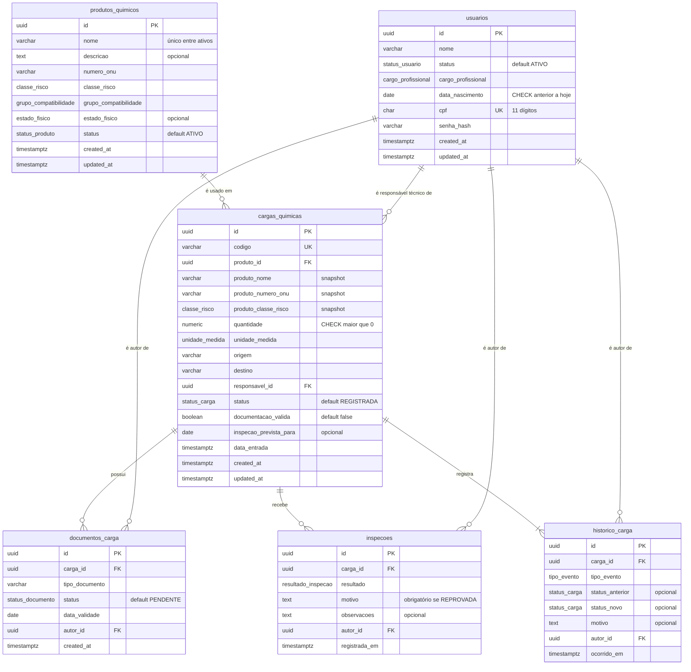
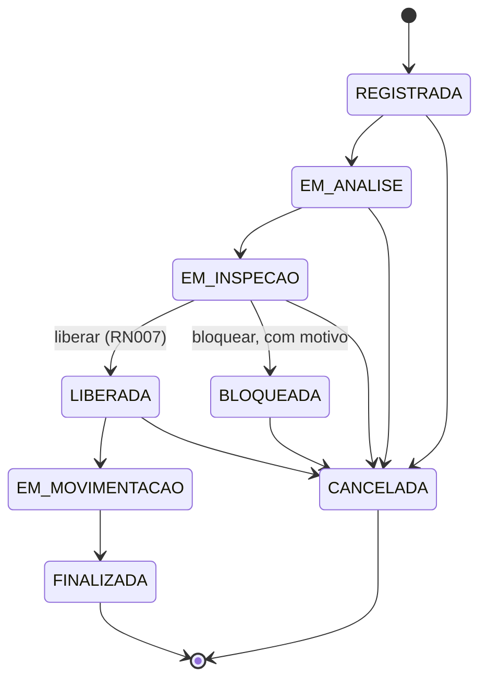

# QuimiPort — Modelagem de Dados

**Sistema:** Gestão de Cargas Químicas Portuárias  
**Contexto:** Tech Challenge Fase 2 — Pós Tech Full Stack Development  
**Documentos relacionados:** QuimiPort - Regras de Negócio (v1.3), QuimiPort - Épicos e Histórias de Usuário (v1.3), QuimiPort - Regras de Negócio Não Implementadas (v1.2)  
**Versão:** 1.3

---

## Histórico de alterações

| Versão | Data | Responsável | Descrição |
|---|---|---|---|
| 1.0 | 05/10/2026 | Ionara Lima | Versão inicial: escolha do banco, DER, dicionário de dados, controle de status, restrições no banco e evolução prevista. |
| 1.1 | 05/10/2026 | Ionara Lima | Alinhamento à máquina de estados do enunciado (Regras de Negócio v1.2): remoção do desbloqueio. Retirada da coluna `ultimo_desbloqueio_em` e do evento `DESBLOQUEIO`; simplificação da verificação de inspeção aprovada (RN027); inclusão da tabela de transições permitidas no controle de status; desbloqueio registrado como evolução futura. |
| 1.2 | 05/10/2026 | Ionara Lima | Inclusão da seção "Convenções", com o padrão de nomenclatura entre documentos, banco de dados e API. Retirada da evolução prevista para a cadeia Classificação de Risco → Risco → Documento Obrigatório e para o responsável técnico como entidade. Padronização da estrutura do documento. |
| 1.3 | 22/10/2026 | Gabriel Marques | Alinhamento ao banco implementado (`database/schema.sql`) e à API: inclusão da tabela `usuarios`; responsável técnico e autores passam a ser chaves estrangeiras para `usuarios`; grupo de compatibilidade e status do documento como enums; autor informado no corpo das requisições (`autorId`); criação do banco pelo `schema.sql` em vez de migrations. Detalhamento abaixo. |

### Detalhamento da versão 1.3

- Inclusão da tabela `usuarios` (seção 5.2) no DER, no dicionário de dados e na correspondência de campos. Usuários deixaram de ser evolução futura (seção 12).
- `cargas_quimicas.responsavel_tecnico` (texto) substituída por `responsavel_id`, chave estrangeira para `usuarios`. O responsável precisa ser um usuário ativo com cargo `RESPONSAVEL_TECNICO` (RN009).
- Colunas `autor` (texto) de `documentos_carga`, `inspecoes` e `historico_carga` substituídas por `autor_id`, chave estrangeira para `usuarios`. O autor é informado no campo `autorId` do corpo das requisições de carga, e não mais no cabeçalho `X-Usuario` (seção 5.8).
- `grupo_compatibilidade` passou de `varchar(5)` para o enum `grupo_compatibilidade`. Inclusão do enum `status_documento` e da coluna `documentos_carga.status`.
- A liberação da carga nesta fase verifica o atributo `documentacao_valida`, informado no registro. A verificação por documentos e inspeções (RN027) foi mantida como referência para a próxima etapa (seção 9.5).
- O banco é criado pelo script `database/schema.sql`. O `prisma/schema.prisma` apenas espelha esse script para gerar o client (seção 13).
- Atualização da versão do PostgreSQL (17) e do tamanho padrão de página das listagens (20).

---

## Sumário

1. Convenções
2. Objetivo
3. Banco de dados escolhido
4. Diagrama entidade-relacionamento
5. Dicionário de dados
6. Como os produtos químicos são armazenados
7. Como as cargas químicas são armazenadas
8. Como uma carga se relaciona com um produto químico
9. Como o status da carga é controlado
10. Consultas e atualizações implementadas
11. Divisão das validações entre banco e domínio
12. Como os dados poderão evoluir nas próximas fases
13. Como aplicar a modelagem

---

## 1. Convenções

### Siglas

- **RN** = Regra de Negócio, no documento "QuimiPort - Regras de Negócio".
- **US** = User Story (história de usuário), no documento "QuimiPort - Épicos e Histórias de Usuário".
- **RNF** = Requisito Não Funcional, no documento "QuimiPort - Épicos e Histórias de Usuário".

### Regras de nomenclatura

| Elemento | Padrão | Exemplo |
|---|---|---|
| Nome nos documentos | Português, com acentos, em letras minúsculas no meio da frase | classe de risco, Em análise |
| Tabela no banco | `snake_case`, no plural, sem acentos | `cargas_quimicas` |
| Coluna no banco | `snake_case`, no singular, sem acentos | `numero_onu` |
| Chave estrangeira | nome da tabela referenciada no singular + `_id`, ou o papel do registro referenciado + `_id` | `produto_id`, `responsavel_id`, `autor_id` |
| Coluna de snapshot | prefixo da tabela de origem + nome da coluna original | `produto_classe_risco` |
| Datas de controle | `created_at` e `updated_at` | `created_at` |
| Tipo enumerado no banco | `snake_case`, no singular | `status_carga` |
| Valor de enum | `MAIUSCULAS_COM_SUBLINHADO`, sem acentos | `EM_ANALISE` |
| Model no Prisma | `PascalCase`, no singular, mapeado para a tabela com `@@map` | `CargaQuimica` → `cargas_quimicas` |
| Campo no Prisma e na API | `camelCase`, mapeado para a coluna com `@map` | `numeroOnu` → `numero_onu` |

### Correspondência de campos

| Nome nos documentos | Campo no Prisma e na API | Tabela e coluna no banco |
|---|---|---|
| Usuário | `Usuario` | `usuarios` |
| Nome do usuário | `nome` | `usuarios.nome` |
| CPF | `cpf` | `usuarios.cpf` |
| Cargo profissional | `cargoProfissional` | `usuarios.cargo_profissional` |
| Data de nascimento | `dataNascimento` | `usuarios.data_nascimento` |
| Status do usuário | `status` | `usuarios.status` |
| Produto químico | `ProdutoQuimico` | `produtos_quimicos` |
| Nome | `nome` | `produtos_quimicos.nome` |
| Descrição | `descricao` | `produtos_quimicos.descricao` |
| Número ONU | `numeroOnu` | `produtos_quimicos.numero_onu` |
| Classe de risco | `classeRisco` | `produtos_quimicos.classe_risco` |
| Grupo de compatibilidade | `grupoCompatibilidade` | `produtos_quimicos.grupo_compatibilidade` |
| Estado físico | `estadoFisico` | `produtos_quimicos.estado_fisico` |
| Status do produto | `status` | `produtos_quimicos.status` |
| Carga química | `CargaQuimica` | `cargas_quimicas` |
| Código da carga | `codigo` | `cargas_quimicas.codigo` |
| Produto associado | `produtoId` | `cargas_quimicas.produto_id` |
| Quantidade | `quantidade` | `cargas_quimicas.quantidade` |
| Unidade de medida | `unidadeMedida` | `cargas_quimicas.unidade_medida` |
| Origem | `origem` | `cargas_quimicas.origem` |
| Destino | `destino` | `cargas_quimicas.destino` |
| Responsável técnico | `responsavelTecnicoId` (API) / `responsavelId` (Prisma) | `cargas_quimicas.responsavel_id` |
| Documentação válida | `documentacaoValida` | `cargas_quimicas.documentacao_valida` |
| Data de entrada | `dataEntrada` | `cargas_quimicas.data_entrada` |
| Status da carga | `status` | `cargas_quimicas.status` |
| Documento da carga | `DocumentoCarga` | `documentos_carga` |
| Tipo de documento | `tipoDocumento` | `documentos_carga.tipo_documento` |
| Data de validade | `dataValidade` | `documentos_carga.data_validade` |
| Inspeção | `Inspecao` | `inspecoes` |
| Resultado da inspeção | `resultado` | `inspecoes.resultado` |
| Histórico da carga | `HistoricoCarga` | `historico_carga` |
| Autor da operação | `autorId` | `documentos_carga.autor_id`, `inspecoes.autor_id`, `historico_carga.autor_id` |
| Data de criação | `createdAt` (Prisma) / `criadoEm` (API) | `created_at` |
| Data de atualização | `updatedAt` (Prisma) / `atualizadoEm` (API) | `updated_at` |

### Correspondência de valores

| Campo | Nome nos documentos | Valor no banco e na API |
|---|---|---|
| Status do usuário | Ativo, Inativo | `ATIVO`, `INATIVO` |
| Cargo profissional | Operador, Inspetor, Responsável técnico, Gestor, Administrador | `OPERADOR`, `INSPETOR`, `RESPONSAVEL_TECNICO`, `GESTOR`, `ADMINISTRADOR` |
| Status do produto | Ativo, Inativo | `ATIVO`, `INATIVO` |
| Status da carga | Registrada | `REGISTRADA` |
| | Em análise | `EM_ANALISE` |
| | Em inspeção | `EM_INSPECAO` |
| | Liberada | `LIBERADA` |
| | Bloqueada | `BLOQUEADA` |
| | Em movimentação | `EM_MOVIMENTACAO` |
| | Finalizada | `FINALIZADA` |
| | Cancelada | `CANCELADA` |
| Status do documento | Pendente, Válido, Inválido, Vencido | `PENDENTE`, `VALIDO`, `INVALIDO`, `VENCIDO` |
| Resultado da inspeção | Aprovada, Reprovada | `APROVADA`, `REPROVADA` |
| Classe de risco | Classe 1 a Classe 9 | `CLASSE_1` a `CLASSE_9` |
| Estado físico | Sólido, Líquido, Gasoso | `SOLIDO`, `LIQUIDO`, `GASOSO` |
| Unidade de medida | kg, t, L, m³ | `KG`, `T`, `L`, `M3` |

---

## 2. Objetivo

Este documento apresenta a modelagem de dados da API do QuimiPort na Fase 2: tabelas, campos, chaves primárias, chaves estrangeiras, relacionamentos e restrições. Explica como usuários, produtos e cargas são armazenados, como se relacionam, como o status da carga é controlado e como o modelo poderá evoluir.

Os artefatos de implementação estão em:

| Artefato | Caminho | Conteúdo |
|---|---|---|
| Script do banco | `database/schema.sql` | Fonte da verdade: enums, tabelas, chaves, índices, CHECKs, índice único parcial e triggers append-only |
| Schema Prisma | `prisma/schema.prisma` | Espelho do script, usado para gerar o client do Prisma (models, enums, chaves e índices) |

---

## 3. Banco de dados escolhido

**Escolha:** PostgreSQL 17, acessado pela aplicação por meio do Prisma ORM (versão 6).

### Justificativa

| Critério do enunciado | Análise |
|---|---|
| **Tipo de dado** | Os dados têm estrutura fixa e conhecida: cada usuário, produto e carga possuem sempre os mesmos campos, com tipos definidos (texto, número decimal, data, valores enumerados). Esse perfil é atendido de forma natural por tabelas com colunas tipadas. A quantidade da carga exige precisão decimal (`numeric`), sem os erros de arredondamento de ponto flutuante. |
| **Relacionamentos** | O domínio é fortemente relacional: uma carga referencia obrigatoriamente um produto (RN004) e um responsável técnico (RN009), e documentos, inspeções e eventos de histórico pertencem a uma carga e a um autor. As chaves estrangeiras garantem no próprio banco que nenhuma carga aponte para um produto ou usuário inexistente e que nenhum registro referenciado seja apagado. |
| **Consistência das regras** | Uma mudança de status exige alterar a carga e inserir o evento de histórico ao mesmo tempo (RN011). As transações ACID do PostgreSQL garantem que as duas operações aconteçam juntas ou não aconteçam. Enums, CHECKs e triggers reforçam no banco as regras mais críticas (status válidos, quantidade positiva, histórico imutável). |
| **Evolução futura** | As próximas fases preveem novas funcionalidades, como autenticação com perfis e anexo de arquivos aos documentos da carga (seção 12). Elas entram como novas tabelas, colunas e chaves estrangeiras, que o modelo relacional absorve sem reestruturar os dados existentes. Se surgir necessidade de dados flexíveis, o PostgreSQL oferece colunas `jsonb` sem trocar de banco. |
| **Coerência com a Fase 1** | A Fase 1 definiu a Arquitetura Hexagonal com o banco como adapter de saída. O Prisma fica isolado na camada de infraestrutura (repositórios e gateways), e o domínio não depende dele. |

### Por que não MongoDB

O MongoDB seria adequado se os dados fossem heterogêneos ou se a carga fosse lida sempre como um documento único, sem consultas cruzadas. No QuimiPort, os produtos e usuários são compartilhados por muitas cargas, as consultas filtram cargas por status, produto e responsável, e as regras exigem integridade referencial e atomicidade entre carga e histórico. No MongoDB, essas garantias ficariam a cargo do código da aplicação.

---

## 4. Diagrama entidade-relacionamento



### Relacionamentos

| Relacionamento | Cardinalidade | Chave estrangeira | Ação ao excluir o pai |
|---|---|---|---|
| Produto químico → Carga química | 1:N (um produto, zero ou muitas cargas; toda carga tem exatamente um produto) | `cargas_quimicas.produto_id` → `produtos_quimicos.id` | `RESTRICT` |
| Usuário → Carga química (responsável técnico) | 1:N (toda carga tem exatamente um responsável) | `cargas_quimicas.responsavel_id` → `usuarios.id` | `RESTRICT` |
| Carga química → Documento da carga | 1:N | `documentos_carga.carga_id` → `cargas_quimicas.id` | `RESTRICT` |
| Carga química → Inspeção | 1:N | `inspecoes.carga_id` → `cargas_quimicas.id` | `RESTRICT` |
| Carga química → Histórico | 1:N (toda carga tem ao menos o evento de registro) | `historico_carga.carga_id` → `cargas_quimicas.id` | `RESTRICT` |
| Usuário → Documento, Inspeção e Histórico (autor) | 1:N | `documentos_carga.autor_id`, `inspecoes.autor_id`, `historico_carga.autor_id` → `usuarios.id` | `RESTRICT` |

Todas as chaves estrangeiras usam `RESTRICT`: o banco impede a exclusão física de qualquer registro referenciado. Isso reforça a RN015, segundo a qual a inativação de usuário e de produto e o cancelamento de carga são sempre lógicos.

---

## 5. Dicionário de dados

### 5.1 Tipos enumerados

| Enum | Valores | Regra |
|---|---|---|
| `status_usuario` | `ATIVO`, `INATIVO` | RN009 |
| `cargo_profissional` | `OPERADOR`, `INSPETOR`, `RESPONSAVEL_TECNICO`, `GESTOR`, `ADMINISTRADOR` | RN009, RN020 |
| `status_produto` | `ATIVO`, `INATIVO` | RN021 |
| `classe_risco` | `CLASSE_1` (Explosivos), `CLASSE_2` (Gases), `CLASSE_3` (Líquidos inflamáveis), `CLASSE_4` (Sólidos inflamáveis), `CLASSE_5` (Oxidantes e peróxidos orgânicos), `CLASSE_6` (Tóxicas e infectantes), `CLASSE_7` (Radioativos), `CLASSE_8` (Corrosivos), `CLASSE_9` (Diversos) | RN002, RN014 |
| `grupo_compatibilidade` | `EXPLOSIVOS`, `GASES`, `LIQUIDOS_INFLAMAVEIS`, `SOLIDOS_INFLAMAVEIS`, `OXIDANTES_PEROXIDOS_ORGANICOS`, `TOXICOS_INFECTANTES`, `RADIOATIVOS`, `CORROSIVOS`, `SUBSTANCIAS_PERIGOSAS_DIVERSAS` | US001 |
| `estado_fisico` | `SOLIDO`, `LIQUIDO`, `GASOSO` | US001 |
| `unidade_medida` | `KG`, `T`, `L`, `M3` | US003 |
| `status_carga` | `REGISTRADA`, `EM_ANALISE`, `EM_INSPECAO`, `LIBERADA`, `BLOQUEADA`, `EM_MOVIMENTACAO`, `FINALIZADA`, `CANCELADA` | RN022 |
| `status_documento` | `PENDENTE`, `VALIDO`, `INVALIDO`, `VENCIDO` | US006, US007 |
| `resultado_inspecao` | `APROVADA`, `REPROVADA` | RN025 |
| `tipo_evento` | `REGISTRO`, `MUDANCA_STATUS`, `DOCUMENTO_REGISTRADO`, `DOCUMENTACAO_VALIDADA`, `INSPECAO_REGISTRADA`, `BLOQUEIO`, `LIBERACAO`, `CANCELAMENTO` | RN011 |

As classes de risco seguem as nove classes de produtos perigosos da ONU para transporte.

### 5.2 `usuarios`

| Coluna | Tipo | Nulo | Padrão | Restrições | Regra |
|---|---|---|---|---|---|
| `id` | `uuid` | Não | gerado pela aplicação | **PK** | — |
| `nome` | `varchar(150)` | Não | — | CHECK não vazio | — |
| `status` | `status_usuario` | Não | `ATIVO` | valores do enum | RN009 |
| `cargo_profissional` | `cargo_profissional` | Não | — | valores do enum | RN009 |
| `data_nascimento` | `date` | Não | — | CHECK anterior à data atual | — |
| `cpf` | `char(11)` | Não | — | **UNIQUE**; CHECK 11 dígitos | — |
| `senha_hash` | `varchar(255)` | Não | — | hash scrypt, nunca exposto pela API | RNF002 |
| `created_at` | `timestamptz(3)` | Não | `now()` | — | — |
| `updated_at` | `timestamptz(3)` | Não | `now()` | atualizado pela aplicação | — |

**Índices:** `usuarios_pkey` (id), `usuarios_cpf_key` (único em cpf), `usuarios_status_idx` (status).

O CPF é armazenado só com dígitos; os dígitos verificadores são validados pelo domínio, e a API devolve o valor formatado (`000.000.000-00`).

### 5.3 `produtos_quimicos`

| Coluna | Tipo | Nulo | Padrão | Restrições | Regra |
|---|---|---|---|---|---|
| `id` | `uuid` | Não | gerado pela aplicação | **PK** | — |
| `nome` | `varchar(150)` | Não | — | CHECK não vazio; único entre ativos (case-insensitive, com trim) | RN001, US001 |
| `descricao` | `text` | Sim | — | — | US001 |
| `numero_onu` | `varchar(10)` | Não | — | — | US001 |
| `classe_risco` | `classe_risco` | Não | — | valores do enum | RN002, RN014 |
| `grupo_compatibilidade` | `grupo_compatibilidade` | Não | — | valores do enum | US001 |
| `estado_fisico` | `estado_fisico` | Sim | — | valores do enum | US001 |
| `status` | `status_produto` | Não | `ATIVO` | valores do enum | RN021 |
| `created_at` | `timestamptz(3)` | Não | `now()` | — | US001 |
| `updated_at` | `timestamptz(3)` | Não | `now()` | atualizado pela aplicação | US028 |

**Índices:** `produtos_quimicos_pkey` (id), `produtos_quimicos_status_idx` (status), `produtos_quimicos_nome_ativo_uk` (único parcial em `lower(btrim(nome))` onde `status = 'ATIVO'`).

### 5.4 `cargas_quimicas`

| Coluna | Tipo | Nulo | Padrão | Restrições | Regra |
|---|---|---|---|---|---|
| `id` | `uuid` | Não | gerado pela aplicação | **PK** | — |
| `codigo` | `varchar(30)` | Não | — | **UNIQUE**; CHECK não vazio | RN026 |
| `produto_id` | `uuid` | Não | — | **FK** → `produtos_quimicos.id` | RN004 |
| `produto_nome` | `varchar(150)` | Não | — | snapshot | RN012 |
| `produto_numero_onu` | `varchar(10)` | Não | — | snapshot | RN012 |
| `produto_classe_risco` | `classe_risco` | Não | — | snapshot; classe de risco herdada do produto | RN004, RN012 |
| `quantidade` | `numeric(14,3)` | Não | — | CHECK `> 0` | RN004 |
| `unidade_medida` | `unidade_medida` | Não | — | valores do enum | US003 |
| `origem` | `varchar(150)` | Não | — | — | US003 |
| `destino` | `varchar(150)` | Não | — | — | US003 |
| `responsavel_id` | `uuid` | Não | — | **FK** → `usuarios.id` | RN009 |
| `status` | `status_carga` | Não | `REGISTRADA` | valores do enum | RN022, RN024 |
| `documentacao_valida` | `boolean` | Não | `false` | — | RN007, US007 |
| `inspecao_prevista_para` | `date` | Sim | — | — | US008 |
| `data_entrada` | `timestamptz(3)` | Não | — | — | US003 |
| `created_at` | `timestamptz(3)` | Não | `now()` | — | — |
| `updated_at` | `timestamptz(3)` | Não | `now()` | atualizado pela aplicação | — |

**Índices:** `cargas_quimicas_pkey` (id), `cargas_quimicas_codigo_key` (único em codigo), `cargas_quimicas_status_idx` (status), `cargas_quimicas_produto_id_idx` (produto_id), `cargas_quimicas_responsavel_id_idx` (responsavel_id).

### 5.5 `documentos_carga`

| Coluna | Tipo | Nulo | Padrão | Restrições | Regra |
|---|---|---|---|---|---|
| `id` | `uuid` | Não | gerado pela aplicação | **PK** | — |
| `carga_id` | `uuid` | Não | — | **FK** → `cargas_quimicas.id` | RN019 |
| `tipo_documento` | `varchar(100)` | Não | — | CHECK não vazio | US006 |
| `status` | `status_documento` | Não | `PENDENTE` | valores do enum | US007 |
| `data_validade` | `date` | Não | — | — | RN013, US006 |
| `autor_id` | `uuid` | Não | — | **FK** → `usuarios.id` | RNF005 |
| `created_at` | `timestamptz(3)` | Não | `now()` | — | — |

**Índices:** `documentos_carga_pkey` (id), `documentos_carga_carga_id_idx` (carga_id).

Para a regra de liberação, a vigência é sempre calculada comparando `data_validade` com a data corrente, mesmo que o status registrado seja `VALIDO`: um documento pode vencer depois de validado.

### 5.6 `inspecoes`

| Coluna | Tipo | Nulo | Padrão | Restrições | Regra |
|---|---|---|---|---|---|
| `id` | `uuid` | Não | gerado pela aplicação | **PK** | — |
| `carga_id` | `uuid` | Não | — | **FK** → `cargas_quimicas.id` | US009 |
| `resultado` | `resultado_inspecao` | Não | — | valores do enum | RN025 |
| `motivo` | `text` | Sim | — | CHECK: obrigatório quando `REPROVADA` | RN025 |
| `observacoes` | `text` | Sim | — | — | US009 |
| `autor_id` | `uuid` | Não | — | **FK** → `usuarios.id` | RNF005 |
| `registrada_em` | `timestamptz(3)` | Não | `now()` | — | RN027 |

**Índices:** `inspecoes_pkey` (id), `inspecoes_carga_id_registrada_em_idx` (carga_id, registrada_em desc), usado para buscar a inspeção mais recente de uma carga, e `inspecoes_autor_id_idx` (autor_id).

### 5.7 `historico_carga`

| Coluna | Tipo | Nulo | Padrão | Restrições | Regra |
|---|---|---|---|---|---|
| `id` | `uuid` | Não | gerado pelo banco | **PK** | — |
| `carga_id` | `uuid` | Não | — | **FK** → `cargas_quimicas.id` | RN011 |
| `tipo_evento` | `tipo_evento` | Não | — | valores do enum | RN011 |
| `status_anterior` | `status_carga` | Sim | — | nulo no evento de registro | RN011 |
| `status_novo` | `status_carga` | Sim | — | CHECK: obrigatório em eventos que mudam status | RN011 |
| `motivo` | `text` | Sim | — | — | RN028, US005 |
| `autor_id` | `uuid` | Não | — | **FK** → `usuarios.id` | RNF005 |
| `ocorrido_em` | `timestamptz(3)` | Não | `now()` | — | RNF005 |

**Índices:** `historico_carga_pkey` (id), `historico_carga_carga_id_ocorrido_em_idx` (carga_id, ocorrido_em desc), que atende à linha do tempo em ordem cronológica reversa (US015), e `historico_carga_autor_id_idx` (autor_id).

**Imutabilidade:** triggers rejeitam `UPDATE`, `DELETE` e `TRUNCATE` na tabela (seção 9.4).

### 5.8 Autor das operações

A Fase 2 não implementa autenticação nem sessão (RN020 não implementada). Por isso, toda operação que altera uma carga recebe no corpo da requisição o campo obrigatório `autorId`, com o UUID do usuário que a executa:

```json
PATCH /cargas-quimicas/{id}/bloquear
{ "motivo": "Lacre violado", "autorId": "6050bc1d-94ed-4be2-a1f0-338c3d174aa6" }
```

O valor é gravado em `historico_carga.autor_id`. Antes de gravar, o caso de uso confere que o usuário existe e está ativo (422 caso contrário), e a chave estrangeira garante a integridade no banco. Quando a autenticação for implementada, o autor passará a vir do usuário autenticado: muda apenas o adapter HTTP, sem alteração nas tabelas nem nos casos de uso (seção 12).

---

## 6. Como os produtos químicos são armazenados

Cada produto químico é uma linha da tabela `produtos_quimicos`, identificada por um UUID.

- **Campos obrigatórios:** nome (RN001) e classe de risco (RN002) são `NOT NULL`. O nome também tem um CHECK que rejeita texto vazio ou formado só por espaços.
- **Valores controlados:** classe de risco, grupo de compatibilidade, estado físico e status são tipos enumerados do PostgreSQL. O banco rejeita qualquer valor fora da lista (RN014, RN021).
- **Unicidade do nome:** um índice único parcial impede dois produtos **ativos** com o mesmo nome, sem diferenciar maiúsculas de minúsculas e ignorando espaços nas pontas (US001, cenário 04). Produtos inativos ficam fora do índice, então um produto pode ser inativado e um novo cadastrado com o mesmo nome.
- **Inativação lógica:** o endpoint `PATCH /produtos-quimicos/:id/inativar` altera `status` para `INATIVO` e atualiza `updated_at`. O registro nunca é apagado (RN015), e a chave estrangeira com `RESTRICT` impede a exclusão física de produtos com cargas.
- **Uso em novas cargas:** o caso de uso de registro de carga lê o produto e rejeita o registro quando o status é `INATIVO` (RN003). Cargas já registradas continuam apontando para o produto inativo normalmente.

---

## 7. Como as cargas químicas são armazenadas

Cada carga química é uma linha da tabela `cargas_quimicas`, identificada por um UUID e por um código de negócio único (RN026).

- **Dados obrigatórios:** código, produto, quantidade, unidade, origem, destino, responsável técnico e data de entrada são `NOT NULL`. A quantidade é `numeric(14,3)` com CHECK `> 0` (RN004). Se a data de entrada não for informada, a API usa o momento do registro.
- **Status inicial:** o valor padrão da coluna `status` é `REGISTRADA` (RN024).
- **Snapshot do produto (RN012):** no registro, o nome, o número ONU e a classe de risco do produto são copiados para as colunas `produto_*` da carga. Se o produto for editado depois (US028), a carga mantém os dados vigentes no momento do registro. A classe de risco da carga é, portanto, herdada do produto e não informada pelo cliente (RN004).
- **Responsável técnico (RN009):** referência ao usuário em `responsavel_id`. No registro, o caso de uso exige que o usuário exista (404), esteja ativo e tenha o cargo `RESPONSAVEL_TECNICO` (422).
- **Documentação obrigatória:** nesta fase, a carga é registrada com o atributo `documentacao_valida` (padrão `false`), que indica se a documentação obrigatória foi apresentada. A liberação exige `true` (RN007). A tabela `documentos_carga` já existe para o registro individual dos documentos, previsto para a próxima etapa (seção 9.5).
- **Histórico:** o registro e cada mudança de status geram uma linha em `historico_carga`, com o autor informado em `autorId` (seções 5.8 e 9.4).
- **Cancelamento lógico:** `PATCH /cargas-quimicas/:id/cancelar` altera o status para `CANCELADA` e registra o motivo no histórico. A carga permanece armazenada (RN015).

---

## 8. Como uma carga se relaciona com um produto químico

O relacionamento é **1:N**: um produto pode estar em zero ou muitas cargas, e cada carga referencia exatamente um produto.

- A coluna `cargas_quimicas.produto_id` é `NOT NULL` e é **chave estrangeira** para `produtos_quimicos.id`. O banco rejeita uma carga sem produto ou com um produto inexistente (RN004).
- A ação `ON DELETE RESTRICT` impede apagar um produto que tenha cargas.
- A regra de produto inativo (RN003) não é uma restrição estrutural, porque depende do status do produto **no momento do registro**: um produto inativado depois continua válido para as cargas antigas. Por isso, ela é verificada no caso de uso de registro.
- O índice `cargas_quimicas_produto_id_idx` acelera a consulta das cargas de um produto (`GET /cargas-quimicas?produtoId=...`).

A carga guarda duas informações sobre o produto, com papéis diferentes:

| Informação | Colunas | Finalidade |
|---|---|---|
| Referência | `produto_id` | Integridade e navegação: qual produto é, consulta dos dados atuais do produto |
| Snapshot | `produto_nome`, `produto_numero_onu`, `produto_classe_risco` | Auditoria: como o produto estava no momento do registro (RN012) |

Na aplicação, o módulo de cargas consulta o produto por meio de uma Port (`ProdutoQuimicoGateway`), sem depender da camada de aplicação do módulo de produtos. O mesmo vale para usuários (`UsuarioGateway`).

---

## 9. Como o status da carga é controlado

O controle é feito em quatro camadas complementares.

### 9.1 Valores válidos: enum no banco (RN022)

A coluna `status` usa o tipo enumerado `status_carga`. Qualquer valor fora dos oito status é rejeitado pelo PostgreSQL, mesmo em uma escrita feita fora da API.

### 9.2 Transições válidas: máquina de estados no domínio (RN010)

As transições são regra de negócio e ficam no agregado `CargaQuimica` da camada de domínio, a partir de um mapa único (`TRANSICOES_PERMITIDAS`, em `src/modules/cargas/domain/value-objects/status-carga.ts`). O mapa reproduz exatamente a máquina de estados do enunciado (RN010):

| Status de origem | Status de destino permitidos |
|---|---|
| `REGISTRADA` | `EM_ANALISE`, `CANCELADA` |
| `EM_ANALISE` | `EM_INSPECAO`, `CANCELADA` |
| `EM_INSPECAO` | `LIBERADA`, `BLOQUEADA`, `CANCELADA` |
| `LIBERADA` | `EM_MOVIMENTACAO`, `CANCELADA` |
| `BLOQUEADA` | `CANCELADA` |
| `EM_MOVIMENTACAO` | `FINALIZADA` |
| `FINALIZADA` | — (estado terminal) |
| `CANCELADA` | — (estado terminal) |

Qualquer combinação fora dessa tabela é rejeitada com 422, incluindo os exemplos de transições proibidas do enunciado (Cancelada → Liberada, Finalizada → Em movimentação, Bloqueada → Em movimentação, Registrada → Finalizada, Em inspeção → Finalizada e Liberada → Registrada). Os casos previstos nas histórias de usuário recebem mensagens específicas, como "Carga bloqueada — movimentação proibida" e "Carga cancelada não pode ser liberada".

O endpoint genérico `PATCH /cargas-quimicas/:id/status` aplica as mesmas regras dos endpoints dedicados: pedir `LIBERADA`, `BLOQUEADA` ou `CANCELADA` por ele equivale a chamar `/liberar`, `/bloquear` ou `/cancelar`. Bloqueio e cancelamento exigem motivo.



As transições **não** são implementadas por trigger no banco. Essa decisão mantém a regra em um único lugar (o domínio), testável sem banco, como prevê a Arquitetura Hexagonal da Fase 1. O banco protege as invariantes que não dependem de contexto (valores válidos, quantidade positiva, histórico imutável).

### 9.3 Gravação atômica e protegida contra concorrência

Toda mudança de status segue o mesmo padrão no repositório, dentro de **uma transação**:

1. Atualizar a carga **condicionando ao status lido**:

   ```sql
   UPDATE cargas_quimicas
      SET status = 'LIBERADA', updated_at = now()
    WHERE id = $1
      AND status = 'EM_INSPECAO';   -- status que o domínio validou
   ```

2. Se nenhuma linha for afetada, outra requisição alterou a carga no intervalo. A transação é desfeita e a API responde **409 Conflict**.
3. Inserir o evento em `historico_carga` com status anterior, status novo, motivo, autor e data/hora.
4. Confirmar a transação.

Assim, nunca existe uma carga com status alterado sem o evento correspondente no histórico (RN011), e duas requisições simultâneas não conseguem aplicar transições conflitantes sobre o mesmo status de origem.

No Prisma, o passo 1 corresponde a `tx.cargaQuimica.updateMany({ where: { id, status: statusPersistido }, data: { status, updatedAt } })`, verificando `count === 0`, dentro de `prisma.$transaction` (`PrismaCargaQuimicaRepository.salvarMudancaStatus`). O registro da carga usa a mesma transação para inserir a carga e o evento `REGISTRO`.

### 9.4 Histórico imutável (RN011, RNF005)

A tabela `historico_carga` é **append-only**: triggers do PostgreSQL rejeitam `UPDATE`, `DELETE` e `TRUNCATE`. A imutabilidade é garantida pelo banco, e não apenas pela ausência desses comandos no código. Um CHECK exige `status_novo` nos eventos que mudam status.

Eventos gravados pela API nesta fase:

| Operação | `tipo_evento` | Motivo |
|---|---|---|
| Registro da carga | `REGISTRO` | — |
| Transição genérica (`/status`) | `MUDANCA_STATUS` | opcional |
| Liberação | `LIBERACAO` | — |
| Bloqueio | `BLOQUEIO` | obrigatório |
| Cancelamento | `CANCELAMENTO` | obrigatório |

### 9.5 Dados de apoio às regras de liberação e bloqueio

**Implementado nesta fase:**

| Regra | Como os dados apoiam a verificação |
|---|---|
| **RN007** (documentação obrigatória) | A liberação exige `documentacao_valida = true`, valor informado no registro da carga. |
| **RN005** (carga bloqueada) | A partir de `BLOQUEADA`, o domínio só aceita `CANCELADA`; movimentação e liberação são rejeitadas com mensagem específica. |
| **RN006** (carga cancelada) | `CANCELADA` é estado terminal; nenhuma transição posterior é aceita. |

**Previsto para a próxima etapa** (as tabelas já existem e as consultas abaixo servem de referência):

| Regra | Como os dados apoiarão a verificação |
|---|---|
| **RN027, condição 2** (inspeção aprovada) | A inspeção mais recente da carga em `inspecoes` precisa ter `resultado = 'APROVADA'`. |
| **RN027, condição 3** (documentação completa e vigente) | A carga precisa ter ao menos um documento e, para cada `tipo_documento` registrado, ao menos um documento com `data_validade >= CURRENT_DATE`. Documentos vencidos permanecem como histórico, mas não contam (RN013). |
| **RN028** (bloqueio por inspeção reprovada) | Uma inspeção `REPROVADA` e a transição para `BLOQUEADA` são gravadas na mesma transação, com o evento `BLOQUEIO` no histórico. |
| **US007** (validar documentação) | Ao validar, `documentacao_valida` passa a `true` e o evento `DOCUMENTACAO_VALIDADA` é registrado. Na liberação, a vigência é verificada novamente, porque um documento pode vencer entre a validação e a liberação. |

Consulta de referência para a condição 3 da RN027:

```sql
SELECT COUNT(*) > 0
       AND COUNT(*) FILTER (WHERE NOT vigente) = 0 AS documentacao_completa
  FROM (
        SELECT tipo_documento,
               bool_or(data_validade >= CURRENT_DATE) AS vigente
          FROM documentos_carga
         WHERE carga_id = $1
         GROUP BY tipo_documento
       ) AS por_tipo;
```

Consulta de referência para a condição 2 da RN027:

```sql
SELECT resultado = 'APROVADA' AS inspecao_aprovada
  FROM inspecoes
 WHERE carga_id = $1
 ORDER BY registrada_em DESC
 LIMIT 1;   -- nenhuma linha = carga sem inspeção registrada
```

---

## 10. Consultas e atualizações implementadas

Atendimento aos itens mínimos de persistência do enunciado:

| Item mínimo do enunciado | Endpoint | Operação no banco |
|---|---|---|
| Persistência de produtos químicos | `POST /produtos-quimicos` | `INSERT` em `produtos_quimicos` |
| Persistência de cargas químicas | `POST /cargas-quimicas` | Leitura do produto, do responsável e do autor; transação com `INSERT` em `cargas_quimicas` (com snapshot) e `INSERT` do evento `REGISTRO` em `historico_carga` |
| Relacionamento entre carga e produto | `POST /cargas-quimicas`, `GET /cargas-quimicas/:id`, `GET /cargas-quimicas?produtoId=` | FK `produto_id` e snapshot do produto devolvido na resposta |
| Consultas básicas | `GET /usuarios`, `GET /produtos-quimicos`, `GET /cargas-quimicas` e as buscas por `:id` | `SELECT` por id e listagens paginadas (20 itens por padrão, máximo 100), com filtros por `status` e, nas cargas, por produto e responsável |
| Atualizações de dados | `PATCH /usuarios/:id`, `PUT /produtos-quimicos/:id`, `PATCH /cargas-quimicas/:id/status`, `/bloquear`, `/liberar` | `UPDATE` em `usuarios` e `produtos_quimicos`; transações de mudança de status (seção 9.3) |
| Inativação ou cancelamento lógico | `PATCH /usuarios/:id/inativar`, `PATCH /produtos-quimicos/:id/inativar`, `PATCH /cargas-quimicas/:id/cancelar` | `UPDATE` do status para `INATIVO` ou `CANCELADA`; nenhum `DELETE` |

Previstos para a próxima etapa: `POST /cargas-quimicas/:id/documentos` (`INSERT` em `documentos_carga`), `POST /cargas-quimicas/:id/inspecao` (`INSERT` em `inspecoes` e, se reprovada, transição para `BLOQUEADA`) e `GET /cargas-quimicas/:id/historico` (`SELECT` ordenado por `ocorrido_em DESC`).

---

## 11. Divisão das validações entre banco e domínio

As regras críticas são verificadas em duas camadas (defesa em profundidade). O formato da entrada é validado no adapter HTTP (Zod), as regras de negócio no domínio e nos casos de uso, e o banco é a última barreira contra dados inconsistentes.

| Regra | Domínio / aplicação | Banco de dados | Código HTTP |
|---|---|---|---|
| RN001 — nome obrigatório | DTO e entidade | `NOT NULL` + CHECK não vazio | 400 |
| RN002, RN014 — classe de risco obrigatória e válida | DTO e Value Object | `NOT NULL` + enum | 400 |
| RN021 — status do produto válido | Value Object | enum | 400 |
| US001 — nome único entre ativos | caso de uso | índice único parcial | 409 |
| CPF válido e único | Value Object e caso de uso | `UNIQUE` + CHECK 11 dígitos | 400 / 409 |
| RN003 — produto inativo em nova carga | agregado `CargaQuimica` | — (depende do momento do registro) | 422 |
| RN004 — produto associado | DTO e caso de uso | `NOT NULL` + FK | 400 / 404 |
| RN004 — quantidade maior que zero | Value Object `Quantidade` | CHECK `> 0` | 400 |
| RN009 — responsável técnico ativo e habilitado | DTO, caso de uso e agregado | `NOT NULL` + FK | 400 / 404 / 422 |
| RNF005 — autor da operação existente e ativo | DTO e caso de uso | `NOT NULL` + FK | 400 / 422 |
| RN026 — código único | caso de uso | `UNIQUE` | 409 |
| RN022 — status da carga válido | Value Object | enum | 400 |
| RN010 — transições e estados terminais | agregado `CargaQuimica` | — (ver seção 9.2) | 422 |
| RN005, RN006, RN007 — bloqueio, cancelamento e liberação | agregado `CargaQuimica` | — | 422 |
| Motivo de bloqueio e cancelamento | DTO e agregado | — | 400 |
| RN025 — motivo da reprovação | — (próxima etapa) | CHECK | — |
| RN011 — histórico imutável | repositório só insere | triggers append-only | — |
| RN015 — exclusão sempre lógica | casos de uso não excluem | FKs com `RESTRICT` | — |
| Concorrência na mudança de status | repositório | `UPDATE ... WHERE status = <lido>` | 409 |

Se uma violação de unicidade chegar ao banco (por exemplo, duas requisições simultâneas com o mesmo código), o repositório converte o erro do Prisma (`P2002`) no `ErroConflito` correspondente, e o middleware global de erros devolve o código HTTP da tabela acima.

---

## 12. Como os dados poderão evoluir nas próximas fases

O modelo foi desenhado para receber novas funcionalidades com novas tabelas e colunas, sem reestruturar os dados existentes. As funcionalidades não implementadas na Fase 2 estão no documento "QuimiPort - Regras de Negócio Não Implementadas".

| Evolução | Mudança no modelo | Regras / US |
|---|---|---|
| **Documentos e inspeções pela API** | Nenhuma: as tabelas `documentos_carga` e `inspecoes` já existem. A liberação passa a verificar a RN027 completa (seção 9.5). | US006, US007, US009, RN027, RN028 |
| **Autenticação e perfis** | A tabela `usuarios` já existe com `cargo_profissional` e `senha_hash`. A autenticação passa a fornecer o `autor_id` a partir do usuário autenticado, no lugar do campo `autorId` do corpo; a autorização por perfil (RN020) usa o cargo. Se forem necessários perfis múltiplos por usuário, entra uma tabela `perfis` associativa. | RN020, RNF002 |
| **Upload de arquivos** | Novas colunas em `documentos_carga` com a referência do arquivo em um storage externo (chave, nome, tipo MIME, tamanho, hash). O arquivo não é gravado no banco. | US006 |
| **Desbloqueio de carga** (se reintroduzido) | Nova coluna `cargas_quimicas.ultimo_desbloqueio_em` (`timestamptz`), novo valor `DESBLOQUEIO` no enum `tipo_evento` e inclusão de `BLOQUEADA → EM_INSPECAO` no mapa de transições. A inspeção válida para liberação passaria a ser a registrada após o último desbloqueio, sem apagar as anteriores. | RN028 (trecho não implementado), US013 |
| **Volume do histórico** | Se o volume crescer, particionamento de `historico_carga` por período (`PARTITION BY RANGE (ocorrido_em)`), sem alteração na aplicação. | RNF003 |
| **Migrations versionadas** | Quando o banco precisar evoluir com dados que não podem ser descartados, o `schema.sql` passa a ser a migration inicial do Prisma (`prisma migrate`), e as alterações seguintes viram migrations incrementais aplicadas na subida do ambiente e no CI. | — |

---

## 13. Como aplicar a modelagem

O banco é criado pelo script `database/schema.sql`, que contém tudo o que o modelo exige, inclusive o que o Prisma não expressa no schema (CHECKs, índice único parcial e triggers).

- **Docker:** o `docker-compose.yml` monta o script em `/docker-entrypoint-initdb.d/`, e o PostgreSQL o executa na primeira inicialização, com o volume vazio. Depois de alterar o script, é preciso recriar o banco, o que **apaga os dados**:

  ```bash
  npm run docker:reset   # docker compose down -v && docker compose up -d --build
  ```

- **PostgreSQL local:** execute o script diretamente:

  ```bash
  psql -U quimiport -d quimiport -f database/schema.sql
  ```

O `prisma/schema.prisma` espelha o script e serve apenas para gerar o client tipado usado pelos repositórios:

```bash
npm run prisma:generate   # também executado pelo npm run build
```

Ao alterar o banco, atualize os dois arquivos. Para conferir se estão alinhados, `npx prisma db pull --print` mostra o schema lido do banco em execução, que pode ser comparado com o `schema.prisma`.

**Observação sobre a versão do Prisma:** o schema usa o Prisma 6, em que a URL de conexão fica no bloco `datasource` (`url = env("DATABASE_URL")`). No Prisma 7, essa propriedade foi movida para o arquivo `prisma.config.ts`. Se o grupo adotar o Prisma 7, apenas esse ponto muda.
